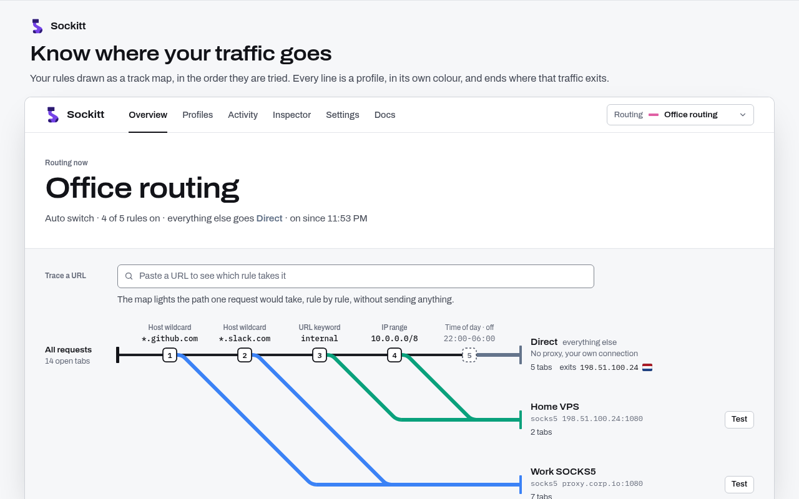
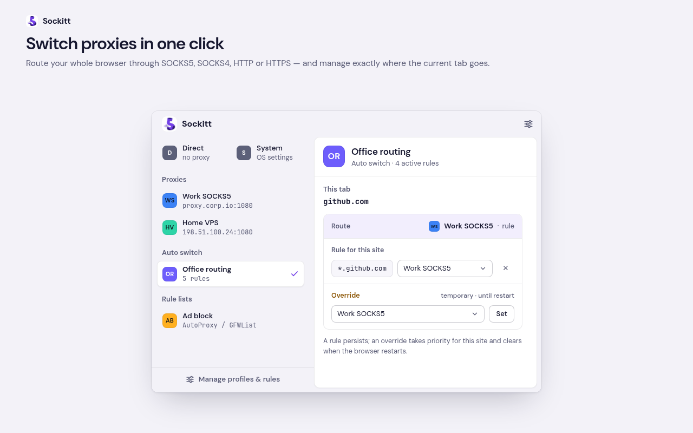
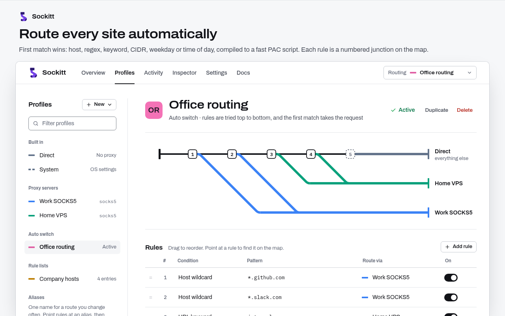
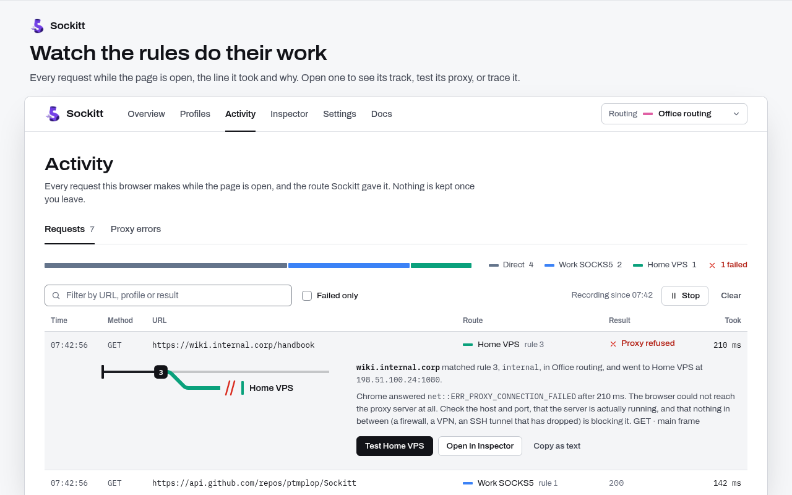

<p align="center">
  <picture>
    <source media="(prefers-color-scheme: dark)" srcset="img/logo-banner-dark.png">
    
  </picture>
</p>

<p align="center">
  <b>A fast, minimal proxy switcher for Chromium browsers.</b><br>
  One-click switching, rule-based auto routing, zero frameworks, Manifest V3.
</p>

<p align="center">
  <a href="https://chromewebstore.google.com/detail/sockitt-%E2%80%94-proxy-switcher/ebfioiljhjgijbmnnpgadkgmokjbjkca">
    
  </a>
</p>

<p align="center">
  <a href="https://chromewebstore.google.com/detail/sockitt-%E2%80%94-proxy-switcher/ebfioiljhjgijbmnnpgadkgmokjbjkca">Chrome Web Store</a> &nbsp;·&nbsp;
  <a href="https://github.com/ptmplop/Sockitt/releases/latest">Releases</a> &nbsp;·&nbsp;
  <a href="docs/rules.md">Rules reference</a> &nbsp;·&nbsp;
  <a href="docs/architecture.md">Architecture</a> &nbsp;·&nbsp;
  <a href="docs/development.md">Development</a>
</p>

---

Sockitt manages your proxies - SOCKS5, SOCKS4, HTTP, and HTTPS - and decides,
per request, whether traffic goes direct or through one. It is a ground-up,
modern take on the classic proxy-switcher extension: no frameworks, a minimal
default permission set, and a rule engine that compiles to an optimised PAC
script.

<p align="center">
  <br>
  <sub>Overview: your rules drawn as a track map, in the order they are tried — every line is a profile, in its own colour, ending where that traffic exits</sub>
</p>
<p align="center">
  <br>
  <sub>Popup: the route this tab takes and the rule that sends it there, and every profile a click — or a number key — away</sub>
</p>
<p align="center">
  <br>
  <sub>Auto switch: an ordered, first-match-wins rule table, compiled to a PAC script — each rule a numbered junction on the map above it</sub>
</p>
<p align="center">
  <br>
  <sub>Activity: every request while the page is open, the line it took and why — open one to see its track, test its proxy, or trace it</sub>
</p>

## Features

- **A map of your routing.** The Overview draws the active profile as a track
  map: requests enter on the left, each rule is a numbered junction in the
  order rules are tried, and a request that matches leaves onto its
  destination's line — every profile drawn in its own colour, ending at its
  name with the tabs on it, a connection test and the measured exit. Paste a
  URL into **Trace a URL** and the map lights the path that one request would
  take. Below it, **Needs attention** lists what is wrong with the
  configuration (patterns that will not compile, rules buried under a
  catch-all, credentials without their permission, stale rule lists, reference
  loops) with one-click fixes, beside a timeline of this session. Everything on
  it is derived from your own configuration — nothing watches your browsing.
- **Proxy profiles.** SOCKS5, SOCKS4, HTTP, or HTTPS servers with a host, port,
  and per-profile bypass list, plus optional username/password authentication
  for HTTP(S) proxies. Each profile has an identity: an initials avatar in a
  colour of your choice, drawn onto the toolbar icon while it is active — as
  long as Sockitt is pinned to the toolbar. Unpinned, the icon shows the plain
  Sockitt mark and names nothing: it then appears only in Chrome's puzzle-piece
  menu, which reads it once when the menu opens and never repaints it, so a
  named icon there could show a profile that has since changed, or another
  window's.
- **Built-in modes.** *Direct* (no proxy) and *System* (use the OS proxy
  settings).
- **Auto Switch profiles.** An ordered, first-match-wins rule table. Route by
  host wildcard (`*.example.com`), host regex, URL wildcard, URL regex, URL
  keyword, IPv4 CIDR (`10.0.0.0/8`), host-label count, weekday, or time of day.
  Rules can target a proxy, Direct, another switch profile, a rule list, or an
  alias.
- **Rule lists.** Subscribe to AutoProxy/GFWList or plain domain lists by URL
  with auto-update, or paste one in. Domain entries compile to a single
  dictionary lookup, so even very large lists stay fast.
- **Aliases.** Pointer profiles: aim many rules at one alias, then retarget them
  all by editing the alias once.
- **Popup switcher.** Change profile in one click, see where the current tab
  routes, retarget or delete the matching rule inline, or set a temporary
  per-site override that lasts only until the browser restarts. An optional
  exit-IP line (off by default) shows where the current tab actually exits —
  flag, IP, and latency, with the country named in the tooltip.
- **Inspector.** Trace any URL through your configuration with the same
  resolver real routing uses: the start profile's map with the path lit, then
  every step — which rule fired, each profile it passed through, where it
  landed.
- **Activity.** Where the Inspector answers for one URL you type, Activity
  answers for everything the browser actually asks for: each request as it
  happens, the route your rules give it and how they decided — rule 2, the
  default, an override, a bypass list — including the subresources a page pulls
  in, which is where a rule quietly not firing hides. Open a request to see its
  track and test its proxy. It records only while its page is open and only in
  that page: nothing is written to disk, and closing or leaving the page
  discards the log and stops the recording. Off until you open it, and it asks
  for the access it needs then.
- **Connection tests.** One click routes briefly through a proxy, measures the
  exit IP/country/latency (auth included), and restores your configuration. Like
  the exit-IP line, this uses the opt-in IP address lookups (off by default).
- **Incognito routing.** Optionally give incognito windows their own profile
  (needs "Allow in Incognito"). Those windows then say so for themselves: the
  toolbar icon over one is that profile's, and the popup opened there reads out
  and switches the incognito profile rather than the active one. Temporary
  overrides stay in the scope they were set in — one chosen in an incognito
  window never follows you back into regular ones, or the reverse. The exit-IP
  line is the exception: in a window on its own incognito profile it reads
  *Exit check runs in regular windows*, because Chrome keeps the two scopes
  apart and the measurement could only be taken on the regular route.
- **Quick switch.** Cycle a chosen set of profiles from the toolbar button or a
  keyboard shortcut, without opening the popup.
- **Sync and control.** Optional configuration sync across machines via your
  browser account, and a startup profile. If another extension takes over the
  browser's proxy settings, Sockitt says so and shows you which one — Chrome
  gives the proxy to the most recently installed extension, so turning that one
  off is what brings Sockitt's routes back.
- **Light and dark.** Follows the system, or keep Sockitt light or dark on one
  device. Every profile colour is adjusted per theme so its line holds 3:1
  against the page and its name 4.5:1.
- **Honest failure states.** When a proxy is down, requests fail closed rather
  than silently leaking direct. A red mark on the toolbar icon says so — with a
  count (`!`, `!4`, `!9+`) once the failure repeats — and **Activity › Proxy
  errors** names the error, explains it, says which proxy was carrying traffic,
  and keeps a log. The mark clears itself after 30 seconds without a new failure,
  because a proxy coming back is something the browser never announces.

## Install

**From the Chrome Web Store (easiest).**
[Sockitt — Proxy Switcher](https://chromewebstore.google.com/detail/sockitt-%E2%80%94-proxy-switcher/ebfioiljhjgijbmnnpgadkgmokjbjkca)
— one click, and it updates itself. Chrome only swaps a new version in while an
extension is idle, though, and Sockitt wakes often enough — for rule lists,
proxy errors, the popup — that a download can sit waiting. When one does, the
options page says so and names both versions; restart the browser to finish it.
Sockitt will not restart itself, because a connection test holds your live proxy
settings while it runs and a reload would leave them where it found them.

**From a release.** Download `sockitt.zip` from the
[latest release](https://github.com/ptmplop/Sockitt/releases/latest) and unzip
it. Open `chrome://extensions`, enable **Developer mode**, click **Load
unpacked**, and select the unzipped folder. Useful for trying a version before
it reaches the store, or for pinning one — unpacked installs do not auto-update.

**From source.**

```sh
git clone https://github.com/ptmplop/Sockitt
cd Sockitt
npm install
npm run build
```

Then load the `dist/` folder unpacked as above. Works on Chrome, Edge, Brave,
Opera, Vivaldi, and other Chromium browsers (Chrome 110+).

## Quick start

1. Open Sockitt's options (right-click the toolbar icon, **Options**), go to
   **Profiles**, and choose **New › Proxy server**. Pick the protocol and enter
   the host and port - for example a SOCKS5 `ssh -D 1080 myserver` tunnel on
   `127.0.0.1:1080`, or an HTTP proxy with a username and password.
2. Pick the profile in the popup. Everything now routes through it.
3. For per-site routing, create an **Auto switch** profile and activate it. As
   you browse, the popup shows where the current tab routes and lets you add or
   edit a rule for it - permanently, or as a temporary override. This works while
   a page is still loading too: a site you cannot reach directly is shown as the
   tab's target the moment it starts loading, so you can route it through a proxy
   and have Sockitt request it again, instead of waiting for it to time out.

See [docs/rules.md](docs/rules.md) for the full pattern syntax and
[docs/architecture.md](docs/architecture.md) for how it works internally.

## Permissions and privacy

By default Sockitt requests four permissions - `proxy`, `storage`, `activeTab`,
and `alarms` - and **no host permissions**. It cannot read your browsing
history, does not touch page content, and contains no analytics of any kind.
By default the only network requests it makes are fetches of rule-list URLs that
you configure; enabling IP address lookups (opt-in, below) adds lookups of
`ipconfig.is`.

Extra capabilities are strictly opt-in and requested only when you use them:

- **Route badge** requests `tabs` and `webNavigation`. Together they ask
  for "Read your browsing history" once — the same prompt `tabs` alone already
  showed. `webNavigation` is what tells the badge a navigation has *started*, so
  a site that never answers stops reading out the previous page's profile. The
  Overview's count of the tabs on each line needs only `tabs`. Either way, tab
  URLs are resolved locally through your own rules, and nothing is stored or
  sent.
- **HTTP/HTTPS proxy authentication** requests `webRequest`,
  `webRequestAuthProvider`, and all-sites access, which Chromium needs to answer
  proxy auth challenges. Sockitt asks when you set credentials.
- **Activity** requests the same grant for a different purpose:
  observing requests so it can list them. It asks the first time you open the
  page, records only in that page, and writes nothing to disk. An install that
  never opens it never grants it. (It asks for `webRequestAuthProvider` too,
  which it never uses — the two are requested as a pair so the worker's proxy
  auth listener keeps working; the provider grants no access on its own.)
- **IP address lookups** - the popup's exit-IP line and connection tests -
  request access to `ipconfig.is`, the IP-echo service they query. Off by
  default; enable them with one setting, which asks for access the first time.
- **Sync** stores your configuration in your own browser account
  (`chrome.storage.sync`). Your browser has to be syncing for it to reach
  anything — signed into Chrome's sync, or joined to a Brave sync chain, with
  Extensions among the types it carries; where the browser has no sync, the
  configuration simply stays on that machine. Switch it on before you set a
  machine up, not after: turned on with a configuration already in sync, this
  machine's is replaced by it; turned on when nothing is synced, this machine's
  becomes the shared one and every other machine with Sync on takes it. Turning
  it off deletes the shared copy, and each machine keeps what it has. Proxy
  credentials are never synced; enter them on each machine.

The proxy error log lives in `chrome.storage.session` alone: it is gone when the
browser restarts, is never written to your saved configuration, and is never
synced. It records proxy addresses and ports, never credentials.

## Limitations

- **No SOCKS authentication.** This is a Chromium limitation, not a Sockitt
  choice; secure SOCKS proxies with an IP allow-list or a local tunnel
  (`ssh -D`, WireGuard, and so on). HTTP and HTTPS proxies support
  username/password auth.
- **IPv4-only CIDR.** CIDR rules match literal IPv4 hosts. Sockitt never
  resolves DNS in the request path, and IPv6 CIDR is not supported.
- **Chromium-family browsers only.**

## Development

```sh
npm install
npm run typecheck   # strict TypeScript, no emit
npm test            # unit suites: generated PAC in a Node VM, plus shared modules
npm run build       # production build to dist/
npm run watch       # dev build with inline sourcemaps
npm run zip         # store-ready sockitt.zip
npm run crx         # signed sockitt.crx for Chrome Web Store uploads
npm run shots       # regenerate the README + store screenshots from the built UI
npm run icons       # regenerate icons, banners and promo tiles from img/logo/ (needs rsvg-convert)
```

Project layout and design notes are in [docs/development.md](docs/development.md); the logo and
how to use it are in [docs/logo.md](docs/logo.md).

## Acknowledgements

Sockitt is an independent, from-scratch implementation. Its concepts - proxy
profiles, PAC-based automatic switching, and the AutoProxy rule-list format -
are informed by
[Proxy SwitchyOmega](https://github.com/FelisCatus/SwitchyOmega) and its
Manifest V3 fork [ZeroOmega](https://github.com/zero-peak/ZeroOmega), which were
studied as a reference while designing this extension. Sockitt shares no code
with those projects and is released under the MIT license. Thanks to their
authors and maintainers for the prior art.

## Privacy

Sockitt has no analytics and no tracking. With **IP address lookups** off (the
default) it contacts no developer-operated server at all; turning them on adds
lookups of `ipconfig.is` — the developer's own IP-echo service — which sees only
your connecting IP, never your configuration or browsing. Your configuration
stays on your device (or your own browser account if you enable Sync). See the
full [Privacy Policy](PRIVACY.md).

## License

[MIT](LICENSE)
